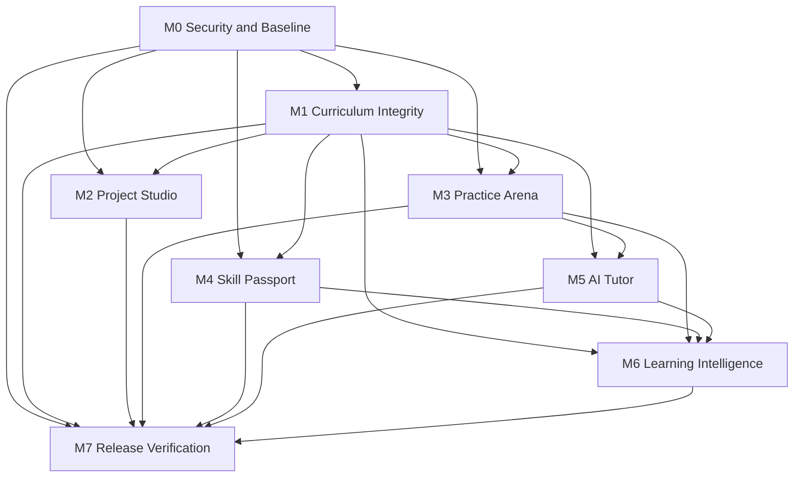

# RUACH LMS — Learning Intelligence & Engineering Excellence
## Milestones, Dependencies and Exit Criteria

**Release:** 1.1
**Status:** Proposed
**Baseline:** Parallel Pathways 1.0.0 and subsequent development through `68b3125`

---

# 1. Milestone Overview

This release is divided into eight milestones.

| Milestone | Name | Priority | Effort |
|---|---|---|---|
| M0 | Security, Data Integrity and Release Baseline | Critical | Medium |
| M1 | Canonical Curriculum and Pathway Integrity | Critical | High |
| M2 | Project Studio and ML Project Corrections | High | Medium–High |
| M3 | Practice Arena 2.1 and Assessment Integrity | High | High |
| M4 | Skill Passport and Competency Verification | Critical | Medium |
| M5 | AI Tutor 3.0 | High | High |
| M6 | Learning Intelligence and Adaptive Practice | Strategic | Very High |
| M7 | Reliability, Accessibility and Release Verification | Critical | High |

Milestones must not be considered complete based solely on implementation progress.

Each milestone requires documented verification and an explicit exit decision.

---

# 2. M0 — Security, Data Integrity and Release Baseline

**Priority:** Critical
**Dependencies:** None
**Purpose:** Establish a secure baseline before expanding the product.

## M0.1 — Source Distribution Hygiene

Tasks:

- Create a dedicated source export process.
- Exclude `.env` and `.env.local`.
- Exclude OAuth client-secret files.
- Exclude databases.
- Exclude profile photos and user uploads.
- Exclude virtual environments.
- Exclude node_modules.
- Exclude editor state and temporary files.
- Exclude test caches and generated artifacts unless explicitly required.

Deliverable:
- `scripts/export_release_source.sh`
- `docs/RELEASE_ARTIFACT_POLICY.md`

Acceptance:
- The generated archive contains only approved files.
- Archive scanning rejects sensitive files.
- Archive size is controlled and documented.

## M0.2 — Credential Audit and Rotation

Tasks:

- Inspect the supplied archive for actual non-placeholder credentials.
- Identify credentials that may have been exposed.
- Rotate affected credentials.
- Verify environment-variable usage.
- Remove hardcoded secrets.
- Review Vercel and Render secret configuration.
- Review Google OAuth configuration.
- Review database and AI provider credentials.
- Review signing keys and administrative tokens.

Deliverable:
- `docs/SECURITY_REMEDIATION_REPORT.md`

Acceptance:
- Every identified exposed credential has a recorded remediation decision.
- No active exposed credential remains.
- Rotation is verified without printing secrets into logs.

## M0.3 — Authorization Audit

Review:

- Authentication.
- Learner ownership.
- Reviewer authorization.
- Admin authorization.
- API permissions.
- CSRF protection.
- Credential issuance.
- Project verification.
- Portfolio publication.
- Lab completion and reset.
- Practice submission.

Acceptance:
- Every protected action has an explicit authorization policy.
- Learners cannot modify other learners' records.
- Learners cannot approve their own verified credentials.
- Unauthorized actions return appropriate HTTP status codes.

## M0.4 — Release Metadata

Implement:

- Application version.
- Git commit SHA.
- Build timestamp.
- Alembic migration revision.
- Deployment environment.
- Readiness status.

Acceptance:
- `/healthz` remains a liveness endpoint.
- `/readyz` reports application/database readiness.
- Release metadata is accessible through a safe diagnostic endpoint.
- Secrets and internal connection strings are never exposed.

## M0 Exit Criteria

- Source archive security scan passes.
- Credential remediation is documented.
- Authorization regression tests pass.
- Release metadata is implemented.
- Backup and recovery procedure is documented.
- No critical security finding remains unresolved.

---

# 3. M1 — Canonical Curriculum and Pathway Integrity

**Priority:** Critical
**Dependencies:** M0
**Purpose:** Make the three-domain curriculum authoritative throughout RUACH.

## M1.1 — Curriculum Registry

Create a canonical curriculum registry.

Required domains:

- `shared-foundations`
- `ai-engineering`
- `machine-learning`

The registry must resolve each domain to its canonical manifest.

It must provide:

- Module lookup.
- Lesson lookup.
- Competency lookup.
- Prerequisite resolution.
- Curriculum version.
- Domain validation.
- Learning objective resolution.

Deliverable:
- `app/curriculum_registry.py`
- `app/services/curriculum.py`

Acceptance:
- All three manifests load successfully.
- Duplicate IDs are rejected.
- Invalid domains are rejected.
- Cross-specialisation prerequisites are rejected.
- Every published lesson resolves through the registry.

## M1.2 — Legacy Curriculum Migration

Tasks:

- Inventory legacy module and lesson IDs.
- Map legacy records to canonical IDs.
- Identify duplicated foundation lessons.
- Define migration behaviour for existing completion records.
- Preserve historical evidence.
- Avoid generating duplicate completion records.
- Document unresolved mappings.

Deliverables:
- `docs/CURRICULUM_ID_MIGRATION.md`
- `app/data/curriculum_legacy_mapping.json`

Acceptance:
- Every existing learner record has a deterministic mapping or an explicitly documented exception.
- No progress is silently discarded.
- Migration is idempotent.
- Duplicate completion records are prevented.

## M1.3 — Shared Foundations Lesson Experience

Tasks:

- Wire the six-module foundation manifest into the lesson catalogue.
- Implement dedicated lesson-detail resolution.
- Implement foundation-specific progress.
- Implement foundation assessment handling.
- Add prerequisite state.
- Add pathway transition links.
- Remove reliance on legacy AI modules for foundation navigation.

Acceptance:
- All published foundation lessons open.
- All published foundation lessons have valid content.
- Completion is persisted.
- Assessment state is correct.
- Foundation progress is displayed independently.
- AI and ML pathways can reuse eligible foundation evidence.

## M1.4 — Independent Pathway Navigation

Tasks:

- Ensure multiple enrolments are supported.
- Distinguish enrolment from active focus.
- Distinguish paused from completed.
- Preserve pathway-specific progress.
- Ensure the dashboard resolves the correct enrolment state.
- Ensure navigation reflects available pathways.
- Remove legacy permanent-destination assumptions.

Acceptance:
- AI-only enrolment works.
- ML-only enrolment works.
- Dual enrolment works.
- Pausing one pathway does not affect the other.
- Switching focus does not modify enrolment or completion.
- No route relies on a single pathway destination as the learner's complete identity.

## M1.5 — Curriculum Contract Tests

Add automated checks for:

- Module counts.
- Lesson counts.
- Unique IDs.
- Prerequisites.
- Domain ownership.
- Learning objectives.
- Competency mappings.
- Lesson route resolution.
- Progress mapping.
- Project references.
- Practice references.

## M1 Exit Criteria

- Three canonical curricula resolve independently.
- Shared Foundations works as a standalone curriculum.
- AI and ML remain independent.
- Existing progress is preserved.
- Dashboard and lesson catalogue agree on enrolment state.
- All curriculum validation tests pass.

---

# 4. M2 — Project Studio and ML Project Corrections

**Priority:** High
**Dependencies:** M0, M1
**Purpose:** Make projects accurate, domain-aware and assessable.

## M2.1 — Manifest-Driven ML Project Templates

Remove hardcoded module-number presentation logic.

Each ML module must define:

- Project title.
- Problem statement.
- Project objectives.
- Dataset.
- Required tasks.
- Starter kit.
- Report schema.
- Evaluation criteria.
- Submission requirements.
- Rubric.

Acceptance:
- No generic fallback is used for modules 4–12.
- All published ML projects display their own instructions.
- Report fields match backend validation.
- Invalid reports return actionable errors.
- Every module has a render and validation test.

## M2.2 — AI Engineering Project Workspace

Implement a dedicated AI Engineering workspace.

It must not be a renamed ML workspace.

Required project artefacts:

- Problem definition.
- Architecture.
- Prompt versions.
- Model configuration.
- Retrieval configuration.
- API contracts.
- Evaluation datasets.
- Agent traces.
- Deployment evidence.
- Technical reflection.

Acceptance:
- AI projects use AI-specific schemas.
- ML project evidence cannot be accidentally displayed as AI project evidence.
- Domain context is enforced at both service and database levels.

## M2.3 — Shared Project Lifecycle

Implement a common lifecycle engine.

Stages:

1. Draft.
2. Planned.
3. In progress.
4. Submitted.
5. Under review.
6. Revision requested.
7. Approved.
8. Published.
9. Archived.

Acceptance:
- Transitions are validated.
- Learner ownership is enforced.
- Reviewer actions are audited.
- Project history is preserved.
- Reassessment is supported.

## M2.4 — Project Milestones and Evidence

Implement:

- Milestone definitions.
- Milestone completion.
- Evidence attachments.
- Technical reflection.
- Assessment feedback.
- Competency mapping.

Acceptance:
- Project milestones persist.
- Evidence is accessible to authorized users only.
- Published portfolio entries expose only approved information.

## M2 Exit Criteria

- All 12 ML project pages are accurate.
- AI Engineering has a distinct project workspace.
- Both domains use a shared lifecycle engine without sharing domain-specific assessment rules.
- Project evidence is auditable.
- Project tests pass.

---

# 5. M3 — Practice Arena 2.1 and Assessment Integrity

**Priority:** High
**Dependencies:** M0, M1
**Purpose:** Turn the existing challenge catalogue into a trustworthy assessment environment.

## M3.1 — ML Challenge Taxonomy

Expand the existing 100+ ML problems across:

- Python for ML.
- Statistics.
- Data analysis.
- Feature engineering.
- Regression.
- Classification.
- Unsupervised learning.
- Model evaluation.
- Deep learning.
- PyTorch.
- Computer vision.
- Reproducible training.
- Production ML.
- MLOps.

Acceptance:
- Each published challenge maps to a curriculum topic.
- Topic coverage is measurable.
- Difficulty distribution is preserved.
- No duplicate challenge IDs exist.
- Challenge schemas validate.

## M3.2 — Isolated Judge Integration

The authoritative judge must be deployed separately from the Flask application.

Required components:

- Submission API.
- Durable queue.
- Isolated worker.
- Resource limits.
- Execution timeout.
- Output limits.
- Submission state.
- Result storage.
- Failure handling.

Acceptance:
- Application server never executes arbitrary learner code directly.
- Disabled judge means Submit is disabled.
- Worker failure does not create false passes.
- Duplicate submissions are handled idempotently.
- Results can be recovered after worker restart.
- Private tests are never sent to the learner browser.

## M3.3 — Submission History

Store:

- Challenge ID.
- Learner ID.
- Submission ID.
- Code version or source hash.
- Timestamp.
- Execution status.
- Passed/failed tests.
- Runtime.
- Memory usage where available.
- Evaluation result.

Acceptance:
- Learners can inspect previous submissions.
- A submission can be associated with a specific challenge version.
- Results cannot be modified by the learner.

## M3.4 — Diagnostic Feedback

Introduce diagnostic categories:

- Syntax error.
- Runtime error.
- Incorrect algorithm.
- Boundary-condition failure.
- Data structure misuse.
- Complexity issue.
- Incorrect assumption.
- Incomplete implementation.

Feedback must be grounded in available execution evidence.

Do not claim to know the cause of a failure when the system only knows that a hidden test failed.

## M3.5 — Adaptive Challenge Recommendations

Recommendations may consider:

- Current module.
- Unmastered concepts.
- Previous challenge attempts.
- Difficulty performance.
- Repeated failure patterns.
- Prerequisite completion.

Acceptance:
- Every recommendation includes a reason.
- Learners can dismiss recommendations.
- Recommendations do not override pathway enrolment or prerequisite rules.

## M3 Exit Criteria

- Judge is safely operational or Submit is honestly disabled.
- ML topic coverage matches the curriculum.
- All challenge records validate.
- Submission history is reliable.
- Diagnostic feedback does not invent hidden-test details.
- Arena regression tests pass.

---

# 6. M4 — Skill Passport and Competency Verification

**Priority:** Critical
**Dependencies:** M0, M1
**Purpose:** Protect the integrity of competency records.

## M4.1 — Role-Based Verification

Define roles:

- Learner.
- Reviewer.
- Instructor.
- Administrator.

Implement explicit permissions.

Learners may submit and request reassessment.

Reviewers may assess evidence.

Administrators may manage reviewer access and exceptional verification policies.

Acceptance:
- Learners cannot verify their own evidence.
- Unauthorized assessment calls are rejected.
- Reviewer identity is recorded.

## M4.2 — Verification History

Record:

- Previous status.
- New status.
- Assessor.
- Timestamp.
- Evidence reference.
- Reason.
- Review notes.

Use append-only history.

## M4.3 — Reassessment and Invalidation

Support:

- Revision requested.
- Reassessment.
- Rejection.
- Verification revocation.
- Historical status inspection.

A revocation must not erase the original verification event.

## M4.4 — Domain Classification

Correctly classify:

- Shared Foundations competencies.
- AI Engineering competencies.
- ML competencies.

Legacy foundation modules must not automatically be classified as AI Engineering.

## M4.5 — Learner Interface

Display:

- Competency.
- Domain.
- Evidence.
- Verification status.
- Reviewer feedback.
- Assessment history.
- Reassessment action.

## M4 Exit Criteria

- Verification permissions are enforced.
- All status transitions are audited.
- Domain classifications are correct.
- Learners can understand the status of every submitted competency.
- Security and regression tests pass.

---

# 7. M5 — AI Tutor 3.0

**Priority:** High
**Dependencies:** M1, M3
**Purpose:** Make the tutor a domain-aware engineering mentor.

## M5.1 — Domain Context Resolver

Resolve context in this order:

1. Explicit lesson or challenge domain.
2. Explicit project domain.
3. Explicit user-selected learning context.
4. Active pathway preference.
5. Shared fallback only when no stronger context exists.

Acceptance:
- Shared lessons always receive Shared Foundations context.
- AI lessons receive AI Engineering context.
- ML lessons receive ML context.

## M5.2 — Instructional Modes

Implement:

- Explain.
- Socratic guide.
- Debug.
- Review.
- Practice.
- Project mentor.
- Assessment preparation.

The learner should be able to understand which mode is active.

## M5.3 — Persistent Learning Context

Store only useful, permission-controlled learning information:

- Concepts studied.
- Demonstrated strengths.
- Repeated misconceptions.
- Unresolved learning gaps.
- Relevant project context.
- Recent instructional progress.

Avoid treating every conversation as verified learning evidence.

## M5.4 — Evaluation Framework

Use domain-specific evaluation datasets.

Evaluate:

- Factual correctness.
- Curriculum alignment.
- Instructional clarity.
- Socratic quality.
- Hint progression.
- Solution leakage.
- Domain confusion.
- Safety.
- Latency.
- Token cost.

Acceptance:
- Evaluation runs are reproducible.
- Model/version metadata is stored.
- Failed evaluations block tutor prompt releases where applicable.
- Model-backed evaluation is distinguished from structural dataset validation.

## M5 Exit Criteria

- All instructional surfaces use the correct domain.
- Tutor modes are functional.
- Persistent context is permission-controlled.
- Evaluation reports are reproducible.
- Latency and cost baselines are recorded.

---

# 8. M6 — Learning Intelligence and Adaptive Practice

**Priority:** Strategic
**Dependencies:** M1, M3, M4, M5
**Purpose:** Establish concept-level mastery and personalized learning recommendations.

## M6.1 — Competency and Concept Graph

Connect:

- Domains.
- Modules.
- Lessons.
- Concepts.
- Competencies.
- Assessments.
- Challenges.
- Projects.
- Prerequisites.

Acceptance:
- Every relationship is explicit.
- Invalid cross-specialisation dependencies are rejected.
- Graph traversal supports prerequisite and recommendation queries.

## M6.2 — Mastery Model

Establish states:

- Not introduced.
- Introduced.
- Practising.
- Developing.
- Proficient.
- Mastered.
- Needs review.

Mastery must be evidence-driven.

Lesson completion alone cannot establish mastery.

## M6.3 — Learning Diagnosis

Identify:

- Weak concepts.
- Repeated errors.
- Prerequisite gaps.
- Assessment inconsistencies.
- Forgotten concepts.

Acceptance:
- Diagnosis includes supporting evidence.
- Inference confidence is recorded where applicable.
- Insufficient evidence produces an unknown state, not an invented diagnosis.

## M6.4 — Adaptive Recommendation Engine

Recommend:

- Lessons.
- Practice challenges.
- Tutor interventions.
- Mini assessments.
- Projects.
- Review sessions.

Recommendations must respect the learner's active domain and prerequisites.

## M6.5 — Spaced Repetition

Implement review scheduling for suitable concepts.

Use learner performance and elapsed time.

Do not apply the same review schedule indiscriminately to every project or competency.

## M6.6 — Mastery Dashboard

Show:

- Domain mastery.
- Concept-level strengths.
- Weak areas.
- Recommended actions.
- Evidence behind mastery.
- Recent changes.

## M6 Exit Criteria

- Concept graph is operational.
- Mastery updates from assessment evidence.
- Recommendations are explainable.
- Review scheduling works.
- Mastery is not confused with verified credentials.

---

# 9. M7 — Reliability, Accessibility and Release Verification

**Priority:** Critical
**Dependencies:** M0–M6
**Purpose:** Prove that the product is reliable and release-ready.

## M7.1 — Database and Migration Reliability

- Fix fresh-SQLite migration portability.
- Use portable server defaults.
- Test Alembic upgrades.
- Test downgrade on disposable databases.
- Verify a single intended migration head.
- Verify production-like migration behaviour.
- Document recovery procedures.

## M7.2 — Performance

- Measure dashboard query counts.
- Measure lesson catalogue query counts.
- Measure Passport query counts.
- Measure Arena catalogue latency.
- Measure tutor response latency.
- Measure project submission latency.
- Benchmark Redis cache behaviour.
- Tune database pools.
- Remove blocking request-thread behaviour from long-lived judge polling.

## M7.3 — Accessibility

Test:

- Keyboard navigation.
- Focus visibility.
- Semantic landmarks.
- Form labels.
- Error announcements.
- Colour contrast.
- Screen-reader labels.
- Responsive navigation.
- Editor accessibility.

## M7.4 — Browser E2E

Cover:

- Registration and login.
- Onboarding.
- Dual enrolment.
- Pathway switching.
- Shared lesson completion.
- AI lesson completion.
- ML lesson completion.
- Practice save and restore.
- Judge submission.
- Tutor interaction.
- Project submission.
- Passport verification.
- Credential display.
- Portfolio privacy.
- Mobile navigation.

## M7.5 — Release Operations

- Reconcile documentation.
- Update release notes.
- Generate release metadata.
- Run security scans.
- Run full tests.
- Run browser tests.
- Verify migrations.
- Deploy to staging.
- Perform authenticated smoke tests.
- Verify production readiness.
- Record rollback identifier.
- Tag the release.

## M7 Exit Criteria

- All critical acceptance criteria pass.
- No unresolved P0/P1 defect remains.
- Full automated suite passes.
- Browser E2E suite passes.
- Migration evidence exists.
- Security and accessibility checks pass.
- Performance baselines are recorded.
- Deployment commit is confirmed.
- Release documentation is consistent.

---

# 10. Milestone Dependencies

# 11. Release Governance

Maintain one authoritative milestone-status document.

Recommended:

`docs/RELEASE_STATUS.md`

Every milestone must record:

- Status.
- Owner.
- Start date.
- Completion date.
- Related commit(s).
- Migration(s).
- Tests.
- Evidence.
- Outstanding issues.
- Approval.

Do not duplicate milestone progress across multiple documents.

The existing `goals.md`, `milestones.md` and `implementation_plan.md` should define intended work. `progress.md` should record implementation history. `docs/RELEASE_STATUS.md` should be authoritative for completion status.

**A milestone is complete only when its exit criteria are demonstrated.**
