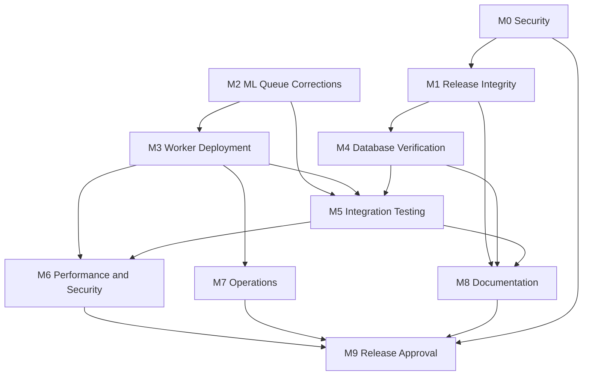

# RUACH LMS — Architecture Evolution 1.0
## Release Closure Milestones

**Purpose:** Complete the outstanding engineering and operational requirements of Architecture Evolution 1.0.

**Status authority:** `docs/RELEASE_STATUS.md`

This document defines the work and exit criteria. It does not independently declare any milestone complete.

---

## Milestone Overview

| ID | Milestone | Priority | Dependency |
|---|---|---|---|
| M0 | Security and Credential Remediation | Critical | None |
| M1 | Git and Release Artifact Integrity | Critical | M0 |
| M2 | ML Queue Lifecycle Corrections | Critical | None |
| M3 | Deployment and Worker Operational Readiness | Critical | M2 |
| M4 | Migration and Database Recovery Verification | Critical | M1 |
| M5 | Full Integration and Regression Verification | Critical | M2, M3, M4 |
| M6 | Performance and Security Acceptance | Critical | M3, M5 |
| M7 | Observability and Operations Closure | High | M3 |
| M8 | Architecture Documentation and Technical Debt Review | High | M1–M7 |
| M9 | Production Release and Owner Approval | Critical | M0–M8 |

---

## M0 — Security and Credential Remediation

**Priority:** Critical
**Objective:** Ensure that sensitive credentials and local development files cannot leak into the source distribution or production workflow.

### Tasks

1. Inspect all sensitive files in the supplied archive.
2. Identify credential names and their intended services without printing values.
3. Reconcile the archive with `docs/SECURITY_REMEDIATION_REPORT.md`.
4. Verify whether credentials previously reported as rotated remain active.
5. Rotate or revoke any credential whose exposure cannot be ruled out.
6. Verify production secret-store values after rotation.
7. Restore and inspect `.gitignore`.
8. Validate `.env.example` contains placeholders only.
9. Exclude:
   - `.env`
   - `.env.local`
   - OAuth client-secret JSON files
   - Private keys and certificates
   - Local databases and backups
   - Uploads and learner-generated local artifacts
   - `.venv`, `venv`, `node_modules`
   - Python caches and test artifacts
10. Strengthen CI secret scanning.
11. Verify that security reports reflect the actual current state.

### Exit Criteria

- No real credential is present in the approved release source.
- Secret scanning passes.
- Credential rotation/revocation has owner-confirmed evidence.
- `.gitignore` and `.env.example` are correct.
- Security remediation documentation is updated.
- No unresolved critical authorization issue remains.

**Owner dependency:** Access to Google Cloud, Google AI Studio, Neon, Render, Vercel and other relevant secret stores.

---

## M1 — Git and Release Artifact Integrity

**Priority:** Critical
**Objective:** Establish one reproducible source of truth for the release.

### Tasks

1. Inspect:
   - Git HEAD.
   - Current branch.
   - Working-tree status.
   - Tags.
   - Application version.
   - Release notes.
   - Reported CI commit.
2. Reconcile the supplied archive's Git revision with its actual uncommitted source changes.
3. Review all intended changes.
4. Commit approved changes.
5. Resolve stale or conflicting version metadata.
6. Restore the canonical release-export workflow.
7. Execute `scripts/export_release_source.sh` from a clean repository.
8. Do not use `--allow-dirty` for the approved release.
9. Inspect the generated manifest.
10. Verify prohibited-path and content scans.
11. Verify SHA-256 checksum.
12. Extract the generated archive into a clean directory.
13. Confirm the extracted application can be prepared using documented setup instructions.

### Exit Criteria

- One approved Git commit identifies the release source.
- Repository working tree is clean.
- Export script succeeds without `--allow-dirty`.
- No prohibited files or real secrets are present.
- Manifest and checksum are generated and verified.
- The release artifact is reproducible.

---

## M2 — ML Queue Lifecycle Corrections

**Priority:** Critical
**Objective:** Make ML job lifecycle transitions safe under cancellation, worker failure, retries and concurrent execution.

### Tasks

#### M2.1 — Define the state machine

Document valid transitions for:

- `queued`
- `running`
- `succeeded`
- `failed`
- `dead_letter`
- `cancelled`

Define which process is authorized to perform each transition.

Terminal states must not be overwritten by stale workers.

#### M2.2 — Correct cancellation

Inspect `app/services/ml_jobs.py`.

The current cancellation implementation sets the job to `cancelled`, but does not invalidate the active worker lease.

Implement a safe cancellation protocol:

- Cancellation must be persisted.
- A running worker must not be able to overwrite a terminal cancellation.
- Lease ownership must be checked during finalization.
- A cancelled job must not produce an authoritative success result.
- The worker must handle cancellation cooperatively where practical.

#### M2.3 — Correct stale-job recovery

The current stale-job recovery requeues expired running jobs without enforcing the retry ceiling.

Implement:

- Expired lease detection.
- Attempt-limit enforcement.
- Requeue only when attempts remain.
- Dead-letter transition when attempts are exhausted.
- Safe clearing of stale lease metadata.
- Recovery metrics and logs.

#### M2.4 — Correct idempotency uniqueness

The enqueue service looks up a key using both `user_id` and `job_key`.

The database constraint must match this intended user-scoped behaviour.

Implement a safe composite uniqueness rule for `(user_id, job_key)`.

The migration must account for existing duplicate keys before applying the constraint.

#### M2.5 — Concurrency and isolation

Test:

- Simultaneous claims.
- Duplicate delivery.
- Stale lease recovery.
- Worker restart.
- Cancellation during processing.
- Retry exhaustion.
- Duplicate enqueue requests.
- Different users using the same idempotency key.
- User ownership of job results.

### Exit Criteria

- All lifecycle transitions are valid.
- Cancellation cannot be overwritten by a stale worker.
- Retry limits are enforced.
- Exhausted jobs become dead-lettered.
- Idempotency behaves consistently.
- Duplicate execution cannot create duplicate authoritative results.
- All ML queue tests pass.

---

## M3 — Deployment and Worker Operational Readiness

**Priority:** Critical
**Objective:** Ensure that declared services can actually run in the selected hosting environment.

### Tasks

1. Inspect `render.yaml`.
2. Verify the current supported service types and plans for the selected hosting provider.
3. Resolve the current background-worker configuration, which specifies `plan: free`.
4. Select an operational hosting plan or an alternative supported deployment arrangement.
5. Estimate the total cost of web, AI worker, ML worker, scheduler and judge infrastructure.
6. Verify environment variables for every process.
7. Establish process restart policies.
8. Establish memory and CPU limits where supported.
9. Establish worker concurrency and job timeout limits.
10. Establish a total database connection budget.
11. Verify that workers do not exceed the database provider's connection limit.
12. Deploy the AI worker independently.
13. Deploy the ML worker independently.
14. Deploy the scheduler.
15. Verify heartbeat freshness.
16. Submit and process real AI and ML jobs.
17. Verify worker failure and restart recovery.
18. Keep judge submissions disabled until its container-capable execution host is verified.

### Exit Criteria

- Every enabled process is deployed on a supported plan.
- AI, ML and scheduler processes report healthy status.
- AI and ML jobs are processed by their respective workers.
- Heartbeats remain fresh.
- Failed processes recover according to policy.
- No queue silently accumulates work because its worker is unavailable.
- Database connection budgets are respected.
- Hosting and recurring costs are documented.

**Owner dependency:** Hosting account, infrastructure approval and budget.

---

## M4 — Migration and Database Recovery Verification

**Priority:** Critical
**Objective:** Verify that the current database schema can safely reach the intended release state.

### Tasks

1. Inspect all migration revision identifiers and parent relationships.
2. Run the migration graph inspection.
3. Confirm there is one intended Alembic head.
4. Reconcile the archive's migration head with `docs/RELEASE_STATUS.md`, `MIGRATION.md` and production records.
5. Specifically investigate the differing reported revisions:
   - `m2n3o4p5q6r7`
   - `h4i5j6k7l8m9`
   - `n9p0q1r2s3t4`
6. Verify the current production revision from the actual database.
7. Create a disposable PostgreSQL/Neon branch.
8. Test a fresh database migration.
9. Test an upgrade from the production-equivalent revision.
10. Test schema and index integrity.
11. Test data preservation.
12. Test the ML queue and result tables.
13. Test rollback or documented forward-recovery procedures.
14. Perform a backup and restore drill.
15. Verify `/readyz` reports the correct migration status.
16. Update migration and recovery documentation.

### Exit Criteria

- Migration graph has one intended head.
- Production and repository revision histories are reconciled.
- Fresh PostgreSQL migration succeeds.
- Upgrade from production-equivalent schema succeeds.
- Backup and restore drill succeeds.
- No critical data loss or schema mismatch occurs.
- Readiness reports the expected state.

**Owner dependency:** Neon access, backup permissions and production migration approval.

---

## M5 — Full Integration and Regression Verification

**Priority:** Critical
**Objective:** Verify that the new architecture has not broken the existing learner or operator experience.

### Tasks

#### Automated tests

1. Run required Python 3.12 and 3.13 test suites.
2. Run architecture boundary tests.
3. Run authorization and security tests.
4. Run AI worker tests.
5. Run ML worker tests.
6. Run queue lifecycle tests.
7. Run migration graph tests.
8. Run browser IDE tests.
9. Investigate all skipped tests.
10. Produce a commit-specific CI report.

#### Browser end-to-end tests

Test complete journeys:

- Registration and login.
- Learner enrolment.
- Shared Foundations progression.
- AI Engineering progression.
- ML progression.
- Independent pathway switching.
- Lesson completion.
- Assessments and review.
- Project creation and submission.
- Practice Arena workflows.
- AI tutor interactions.
- Skill Passport evidence.
- Admin verification and operations.

#### Workload tests

- AI job submission → AI worker → result retrieval.
- ML job submission → ML worker → result retrieval.
- Worker restart while a job is running.
- Queue backlog and recovery.
- Unavailable worker behaviour.
- User ownership and access restrictions.

### Exit Criteria

- Required CI checks pass on the approved commit.
- Critical learner journeys pass.
- AI and ML independence tests pass.
- Worker workflows pass.
- No critical regression remains.
- Test reports identify environment-dependent or skipped tests.

---

## M6 — Performance and Security Acceptance

**Priority:** Critical
**Objective:** Establish evidence that the platform can operate within agreed security and capacity limits.

### Tasks

1. Review the previous load-test report.
2. Establish an agreed staging environment.
3. Agree on virtual-user targets and workload mix.
4. Agree on error-rate, throughput and latency thresholds.
5. Run baseline tests.
6. Run incremental concurrency tests.
7. Run sustained-load tests.
8. Measure p50, p95 and p99 latency.
9. Measure throughput and failure rates.
10. Inspect database connection utilization.
11. Inspect slow queries.
12. Inspect worker queue latency.
13. Inspect memory and CPU utilization.
14. Test rate limiting.
15. Review CSP residual risk.
16. Record accepted risks and remediation owners.

The previous local result of approximately 15% failures and 36.7-second p95 latency at 5,000 virtual users must not be presented as a production capacity benchmark.

### Exit Criteria

- Owner-approved performance thresholds exist.
- Staging tests meet the thresholds.
- Bottlenecks are documented.
- Security residual risks have explicit decisions.
- No unresolved critical vulnerability remains.

**Owner dependency:** Staging infrastructure, load-test budget and threshold approval.

---

## M7 — Observability and Operations Closure

**Priority:** High
**Objective:** Ensure the team can identify, diagnose and recover from production problems.

### Tasks

1. Verify request correlation IDs.
2. Include correlation IDs in worker logs.
3. Track AI queue depth and age.
4. Track ML queue depth and age.
5. Track processing duration and failures by workload.
6. Track worker heartbeats.
7. Verify `/healthz`, `/readyz` and version endpoints.
8. Verify admin operations dashboard.
9. Define alert thresholds.
10. Define alert delivery and ownership.
11. Document unavailable-worker behaviour.
12. Document stuck-job recovery.
13. Document database connection saturation recovery.
14. Test graceful shutdown and restart.
15. Test recovery procedures.

### Exit Criteria

- Application and worker health are independently visible.
- Queue backlogs and stale workers are detectable.
- Logs support job-level investigation.
- Recovery procedures have been tested.
- Operational ownership is documented.

---

## M8 — Documentation and Architecture Governance

**Priority:** High
**Objective:** Ensure that documentation reflects the actual implementation.

### Tasks

1. Review `docs/RELEASE_STATUS.md`.
2. Review `docs/releases/architecture-evolution-1.0.md`.
3. Review `render.yaml`.
4. Review `DEPLOYMENT_ARCHITECTURE.md`.
5. Review `MIGRATION.md`.
6. Review `docs/OPERATIONS_RUNBOOK.md`.
7. Review `docs/BACKUP_AND_RECOVERY.md`.
8. Review `ARCHITECTURE_DECISIONS.md`.
9. Review `docs/architecture/adr_crosswalk.md`.
10. Correct stale claims about ML worker deployment.
11. Reconcile migration-head references.
12. Reconcile CI commit references.
13. Review large modules and domain decomposition debt.
14. Record accepted technical debt and owners.
15. Record milestone exit decisions.

### Exit Criteria

- No material deployment contradiction remains.
- Documentation matches the approved source and deployed services.
- Technical debt has ownership.
- All milestone exit decisions are recorded.

---

## M9 — Production Release and Owner Approval

**Priority:** Critical
**Objective:** Publish Architecture Evolution 1.0 only after all required evidence is available.

### Tasks

1. Confirm M0–M8 exit decisions.
2. Confirm no critical issue remains.
3. Confirm the final source commit.
4. Run the clean release exporter.
5. Verify archive manifest and checksum.
6. Verify required CI.
7. Verify database migration state.
8. Verify production web service.
9. Verify AI worker.
10. Verify ML worker.
11. Verify scheduler.
12. Verify judge decision and execution evidence.
13. Verify learner journeys.
14. Verify performance acceptance.
15. Update release notes.
16. Create the approved Git tag.
17. Publish the release artifact.
18. Record owner approval.

### Exit Criteria

- All mandatory milestone gates pass.
- Production deployment is verified.
- Rollback/recovery is verified.
- Release artifact is clean and traceable.
- Owner approval is recorded.

---

## Dependency Flow

## Governance Rules

1. `docs/RELEASE_STATUS.md` remains the sole authoritative milestone status record.
2. Do not duplicate milestone status in `progress.md` or release notes.
3. Update status only when evidence exists.
4. A completed implementation awaiting verification is `EXIT REVIEW`, not `COMPLETE`.
5. Owner-dependent work must have a named owner and recorded evidence.
6. Do not enable judge submissions without verified container execution.
7. Do not migrate production without a verified backup.
8. Do not publish a release from an unclean working tree.
9. Do not begin Applied Engineering Studio 2.0 as a replacement for unfinished critical closure work.

**Release rule:** Architecture Evolution 1.0 is released only after M9 passes.
